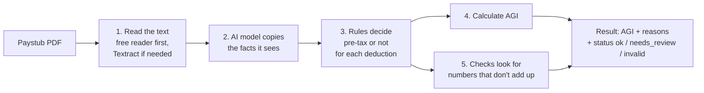

# Paystub AGI

Reads a US paystub (PDF or image), works out which deductions were taken **before tax**, and calculates the person's yearly **AGI** (adjusted gross income), with a reason for every decision.

The repository has two parts:

| Part | Folder | What it is |
|---|---|---|
| **The component** | `src/paystub_agi/` | A reusable Python package. Give it a paystub; it gives back AGI, a status and an explanation. |
| **The evaluation harness** | `evaluation/` | A tool that runs the component on many paystubs and compares the results with answer keys. Not needed to use the component. |

---

## Contents

1. [How it works](#1-how-it-works)
2. [Before you start](#2-before-you-start)
3. [Install](#3-install)
4. [Quick start: try it on a few paystubs](#4-quick-start-try-it-on-a-few-paystubs)
5. [Use the component in your own code](#5-use-the-component-in-your-own-code)
6. [What you get back](#6-what-you-get-back)
7. [The pre-tax rules](#7-the-pre-tax-rules)
8. [How AGI is calculated](#8-how-agi-is-calculated)
9. [Component settings (`config/default.yaml`)](#9-component-settings-configdefaultyaml)
10. [Run the evaluation harness](#10-run-the-evaluation-harness)
11. [Harness settings (`evaluation/config.yaml`)](#11-harness-settings-evaluationconfigyaml)
12. [Use your own paystubs and answer keys](#12-use-your-own-paystubs-and-answer-keys)
13. [Costs](#13-costs)
14. [Troubleshooting](#14-troubleshooting)
15. [Known limitations](#15-known-limitations)
16. [For developers](#16-for-developers)
17. [Repository layout](#17-repository-layout)
18. [More documentation](#18-more-documentation)

---

## 1. How it works



1. **Read.** The paystub is turned into text. A free local reader (`pdfplumber`) is tried first. If the PDF is a scan or the free reader can't read it, Amazon Textract is used.
2. **Extract.** An AI model (through Amazon Bedrock) **copies** what is printed: amounts, labels, headings, codes, footnotes. It is told **not** to decide anything.
3. **Decide.** Fixed rules (R1 to R10) decide, for each deduction, whether it was taken before tax. The AI never makes this decision.
4. **Calculate.** AGI is calculated from the pay, the pre-tax deductions and the pay frequency.
5. **Check.** Consistency checks flag numbers that don't add up (for example, net pay that doesn't match).

**Key principle: the AI extracts, the code decides.** Every pre-tax decision comes with the rule that made it and the exact words on the stub that triggered it, so any result can be explained.

---

## 2. Before you start

You need:

| What | Why |
|---|---|
| **Python 3.14** | The project and the IDP libraries require it. |
| **[uv](https://docs.astral.sh/uv/)** (0.13 or newer) | Installs everything from the lock file. |
| **Access to the three IDP libraries on GitHub** (`idp-core`, `idp-ocr`, `idp-genai`) | They are installed straight from their GitHub repositories (see `pyproject.toml`). Your git login must be able to read them. |
| **An AWS account and login** (e.g. an AWS profile) | For Amazon Bedrock (the AI model) and Amazon Textract (reading scans). |

**AWS permissions your login needs:**

| Service | Permissions | When |
|---|---|---|
| Amazon Bedrock | Invoke the models you choose (Converse API) | Always |
| Amazon Textract | `DetectDocumentText` / `AnalyzeDocument` | Stubs the free reader can't read |
| Amazon Textract | `StartDocumentAnalysis` / `GetDocumentAnalysis` | Multi-page scans (`async` / `auto` mode) |
| Amazon S3 | `PutObject`, `GetObject`, `DeleteObject` on the staging bucket | Multi-page scans (`async` / `auto` mode) |
| Amazon S3 | `ListBucket`, `GetObject` on the paystub bucket | Only the harness `download` command |

**Credentials are never stored in this repository.** They come only from your normal AWS login (for example `$env:AWS_PROFILE="default"`).

---

## 3. Install

Run these from the repository root (PowerShell shown; use `;` between commands, not `&&`):

```powershell
uv sync
```

This creates `.venv` and installs the exact versions in `uv.lock`, including the three IDP libraries.

Check that everything works (no AWS needed):

```powershell
uv run pytest -q
```

All tests should pass. They use fake readers and fake models, so they cost nothing and need no network.

---

## 4. Quick start: try it on a few paystubs

The quickest way to see results is the demo script. It takes your own PDF files and their answer keys, runs one model, and prints the result for each stub.

```powershell
$env:AWS_PROFILE = "default"

uv run python -m evaluation.demo `
  --model-id us.anthropic.claude-sonnet-5 --region us-east-1 --schema-method prompt `
  --stub data/paystubs/advs_paystubs/stub_0002.pdf data/answer_keys/advs_paystubs/stub_0002.json `
  --stub data/paystubs/advs_paystubs/stub_0006.pdf data/answer_keys/advs_paystubs/stub_0006.json
```

**Options:**

| Option | Required | Meaning |
|---|---|---|
| `--stub PDF ANSWER_KEY` | Yes (repeat per stub) | A local paystub file and its answer key (JSON, see [section 12](#12-use-your-own-paystubs-and-answer-keys)). |
| `--model-id` | Yes | The Bedrock model ID. |
| `--region` | Yes | The AWS region, e.g. `us-east-1`. |
| `--provider` | No | `converse` (default) or `mantle`. Use `mantle` only for models that need it. |
| `--schema-method` | No | `tool` (default) or `prompt`. Use `prompt` for Claude Opus 5 and Sonnet 5 (see [Troubleshooting](#14-troubleshooting)). |
| `--temperature` | No | Leave it out to use the model's own default. Claude Opus 5 and Sonnet 5 reject any value. Use `0` for models that accept it. |

**Example output** (illustrative):

```text
stub_0006.pdf: status=ok agi=45760.00 key_agi=45760.00 match=yes
  Medical | 85.00 | not_pretax | R9 | label "Medical"
  401k | 70.40 | not_pretax | R9 | label "401k"
```

Each deduction line shows: **label | amount | decision | rule | the words that triggered the rule**.

> The demo prints values from the paystubs. Use it only on synthetic (test) paystubs. It uses the component's default settings, saves nothing, and can't read multi-page **scanned** PDFs (it uses Textract in `sync` mode).

---

## 5. Use the component in your own code

The component doesn't create any AWS clients itself. **You** create them and pass them in. This keeps credentials, regions and model choices out of the component.

```python
from pathlib import Path

import boto3
from idp_genai.providers.bedrock import bedrock_capabilities
from idp_genai.service import GenAIService
from idp_ocr import TextractReader

from paystub_agi import AnalyzerConfig, FileEvidenceStore, PaystubAgiError, PaystubAnalyzer

region = "us-east-1"
session = boto3.Session(region_name=region)  # uses your AWS login

# 1. The AI model service (Amazon Bedrock, Converse API).
genai = GenAIService.create_bedrock_service(
    client=session.client("bedrock-runtime", region_name=region),
    capabilities=bedrock_capabilities(),
    schema_method="prompt",            # "tool" or "prompt"; see Troubleshooting
)

# 2. Settings: start from the defaults and change only what you need.
config = AnalyzerConfig.from_mapping(
    {"extraction": {"temperature": None}}   # Claude Opus 5 / Sonnet 5 reject a temperature
)
# Or load a YAML file: AnalyzerConfig.from_yaml(Path("config/default.yaml"))

# 3. Build the analyzer (one per model).
analyzer = PaystubAnalyzer.create(
    config,
    genai=genai,
    model="us.anthropic.claude-sonnet-5",
    readers={"textract": TextractReader(region=region)},  # paid reader for scans
    store=FileEvidenceStore(Path("data/ocr_reads")),       # optional: saves OCR reads
)

# 4. Analyse a paystub (a local path or s3://bucket/key).
try:
    result = analyzer.analyze("data/paystubs/advs_paystubs/stub_0006.pdf")
except PaystubAgiError as error:
    print("Could not analyse:", error)
else:
    print(result.status, result.agi.agi)
    for d in result.decisions:
        print(d.line.label, d.line.amount, d.decision, d.rule_id, d.evidence)
```

**`PaystubAnalyzer.create` arguments:**

| Argument | Required | Meaning |
|---|---|---|
| `config` | Yes | An `AnalyzerConfig` (see [section 9](#9-component-settings-configdefaultyaml)). |
| `genai` | Yes | An `idp-genai` service. Decides the provider (Bedrock Converse or Mantle). |
| `model` | Yes | The model ID to call. |
| `readers` | Only for paid readers | Readers by name, e.g. `{"textract": TextractReader(...)}`. Every name in `reading.strategy` except `pdfplumber` must be supplied here. |
| `downloader` | Only for `s3://` paths | An `idp-ocr` S3 downloader, used to fetch the file first. |
| `store` | No | Saves OCR reads so the same file is never paid for twice. The AI model is still called every time. |

**Errors** (all are subclasses of `PaystubAgiError`):

| Error | Meaning |
|---|---|
| `ConfigError` | A setting is wrong or missing. The message says which. |
| `ReadingError` | No reader could read the file (e.g. missing file, unreadable scan, multi-page scan without a staging bucket). |
| `ExtractionError` | The AI model gave no usable answer. `error.code` says why: `refused`, `truncated`, `invalid_json`, `schema_invalid`, `provider_error`, `rejected_input`. |
| `StoreError` | A saved OCR read is damaged. |

The component never returns a made-up number. When information is missing, it says `needs_review` or raises one of these errors.

---

## 6. What you get back

`analyzer.analyze(...)` returns a `PaystubResult`:

| Field | What it holds |
|---|---|
| `status` | `ok`, `needs_review` or `invalid` (see below). |
| `agi` | The AGI result (see the next table). |
| `decisions` | One entry per deduction: `line` (label, amount, heading, codes…), `decision`, `rule_id`, `evidence`. |
| `flags` | Warnings from the consistency checks. |
| `checks_not_run` | Checks that couldn't run (e.g. no tax lines found). |
| `evidence` | Everything the AI copied from the stub. |
| `reader` | Which reader produced the text (`pdfplumber` or `textract`). |
| `read_from_store` | `True` if the OCR read was loaded from the store instead of read again. |

**Status:**

| Status | Meaning |
|---|---|
| `ok` | AGI was calculated and nothing needs a person to look at it. |
| `needs_review` | There's no AGI (e.g. no pay frequency printed), or a decision or check needs a person. |
| `invalid` | Gross pay or taxable wages are $0.00, which isn't valid proof of income. |

**Decisions for each deduction:**

| Decision | Meaning | Effect on AGI |
|---|---|---|
| `pretax` | Taken out before tax | Lowers AGI |
| `not_pretax` | Taken out after tax | No effect |
| `needs_review` | Unclear; a person should check | Shown separately (see `agi_if_review_pretax`) |
| `excluded` | Not the employee's deduction (a tax, or employer-paid) | Ignored |

**The AGI result (`result.agi`):**

| Field | Meaning |
|---|---|
| `agi` | Yearly AGI in dollars, or `None` if it can't be calculated. |
| `agi_if_review_pretax` | The AGI if every `needs_review` deduction turned out to be pre-tax. |
| `method` | How it was calculated: `federal_taxable_wages`, `gross_less_pretax` or `annual_amount`. |
| `pay_frequency`, `periods_per_year` | E.g. `biweekly`, `26`. |
| `frequency_source` | Where the frequency came from: `document` (printed), `period_dates` (worked out from the dates) or `default` (from settings). |
| `one_time_total` | Bonus, overtime etc. counted once. |
| `pretax_total`, `review_total` | Totals of the pre-tax and review deductions. |
| `invalid_proof_of_income` | `True` when pay is $0.00. |
| `warnings` | Plain-language reasons, e.g. "Pay frequency could not be determined". |

All money values are exact decimals (`Decimal`), never floating-point numbers.

---

## 7. The pre-tax rules

Each deduction is checked against these questions **in order**. **The first one that matches decides**, and the rest are skipped. Clear evidence comes first; guesses come last.

| Rule | Question | Example | Result |
|---|---|---|---|
| **R1** | Did the **employer** pay it? ("ER", "Employer"…, or an employer section) | "Medical ER" | `excluded` |
| **R2** | Is it a **tax**? | "Fed Withholding" | `excluded` |
| **R3** | Does the stub **say post-tax**? ("Post", "After Tax", "Roth", or a Pre-Tax column showing "N") | "Roth 401k" | `not_pretax` |
| **R4** | Does the stub **say pre-tax**? ("Pre-Tax", "Before Tax"…, a "PRE" code, a "Pre-Tax" heading, or a Pre-Tax column showing "Y") | "401k Pre-Tax" | `pretax` |
| **R5** | Is it a type of deduction that is **always post-tax**? (garnishment, union dues, charity, child support) | "Child Support" | `not_pretax` |
| **R6** | Does it have a **star (\*)** whose **footnote says pre-tax**? | "Dental\*" + "\*Pre-tax" | `pretax` |
| **R7** | Does it have the code **"EE"**? | "Dental EE" | setting `ee_means` |
| **R8** | Does it have the code **"EMP"**? | "401k EMP" | setting `emp_means` |
| **R9** | Is it a **known benefit** (401k, medical, dental, HSA…) with no other evidence? | "Dental" | setting `bare_benefit_names` |
| **R10** | **Nothing matched.** | "Gym" | setting `unclear_default` |

Good to know:
- **Post-tax wins over pre-tax.** R3 is checked before R4, so "Pre-Tax Roth" counts as post-tax.
- **The current business rule:** if the stub doesn't clearly say pre-tax, the deduction is treated as post-tax.
- **Matching** is whole-word and ignores capital letters. "pre tax" also matches "Pre-Tax"; "er" doesn't match "Water".
- **"PRE" counts only as a code** in its own column, because in a label it also matches words like "Pre-Pocketed".
- **A mixed heading doesn't decide on its own.** A heading such as "Pre-Tax, Taxes, and Other Deductions" says *some* rows are pre-tax but not which ones, so each row needs its own marker.

A one-page summary is in [docs/rules.md](docs/rules.md).

---

## 8. How AGI is calculated

**When the stub prints "federal taxable wages"** (payroll has already removed the pre-tax deductions):

```
AGI = (federal taxable wages − one-time pay) × pay periods per year + one-time pay
```

**Otherwise:**

```
AGI = (gross pay − one-time pay − pre-tax deductions) × pay periods per year + one-time pay
```

- **One-time pay** (bonus, overtime, double time, award) is counted **once**, not multiplied by the number of pay periods.
- **Pay periods per year** come from the printed pay frequency, otherwise from the period start and end dates. If neither is available, there's no AGI and the status is `needs_review` (unless you set `default_frequency`).
- **If only a yearly figure is printed** (e.g. "Annual Salary") and nothing else works, that figure is used.
- **Rounding** happens once, at the end, to the cent (half up).

**Example** (biweekly, 26 periods): gross $1,052.70, a $20.70 bonus, a $87.00 pre-tax Health deduction, no taxable wages printed:
(1,052.70 − 20.70 − 87.00) × 26 + 20.70 = **$24,590.70**

---

## 9. Component settings (`config/default.yaml`)

[config/default.yaml](config/default.yaml) lists **every component setting with its default value**. A test keeps the file and the built-in defaults in sync.

You only need to list the settings you want to change. Anything you leave out keeps its default. For example:

```yaml
rules:
  bare_benefit_names: needs_review
agi:
  one_time_earnings: [bonus, overtime, double time, award, spiff]
```

Load it with `AnalyzerConfig.from_yaml(Path("my_settings.yaml"))`, or put the same keys under `component:` in a harness config ([section 11](#11-harness-settings-evaluationconfigyaml)). Unknown or misspelled keys are rejected with a clear error.

### `reading`: how the paystub is read

| Setting | Default | What it does / effect of changing it |
|---|---|---|
| `strategy` | `[pdfplumber, textract]` | Readers tried in order until one gives usable text. `pdfplumber` is free and local; `textract` is paid. Put `textract` first to skip the free reader; remove it to never pay for OCR (scans will then fail). |
| `max_images` | `3` | Most page images sent to a vision model. More pages = more cost. |
| `image_dpi` | `144` | Image sharpness. Higher = clearer but bigger and more expensive. |
| `image_max_side` | `1568` | Largest image side in pixels. |
| `grayscale` | `true` | Send black-and-white images (smaller). |

Images are only sent if `extraction.send_images` is `auto` **and** the model service supports images.

### `extraction`: how the AI model is asked

| Setting | Default | What it does / effect of changing it |
|---|---|---|
| `send_images` | `auto` | `auto`: send page images when the model supports them. `never`: text only (cheaper; relies on the OCR tables being right). |
| `temperature` | `0` | `0` gives the most repeatable answers. `null` uses the model's own default. **Claude Opus 5 and Sonnet 5 need `null`.** |
| `max_output_tokens` | `8192` | Longest answer allowed. Too low and long stubs come back cut off (`truncated`). |

The model ID is never in this file; it's passed in by the caller.

### `rules`: the five business choices

| Setting | Default | Options | What it decides |
|---|---|---|---|
| `bare_benefit_names` | `not_pretax` | `pretax`, `not_pretax`, `needs_review` | R9: a known benefit (e.g. "Dental") with no pre-tax evidence. `pretax` lowers AGI for these; `needs_review` sends them to a person. |
| `ee_means` | `not_pretax` | `pretax`, `not_pretax`, `needs_review` | R7: what the code "EE" means. |
| `emp_means` | `employee` | `employee`, `employer`, `pretax`, `needs_review` | R8: what "EMP" means. `employee` = the employee's own deduction, so the later rules decide. `employer` = ignore it. |
| `asterisk_scope` | `any` | `any`, `uniform_only` | R6: whether a pre-tax footnote can apply to any starred row, or only to uniform rows. |
| `unclear_default` | `not_pretax` | `not_pretax`, `needs_review` | R10: a deduction nothing matched. `needs_review` sends every unknown deduction to a person. |

**Tip:** to see how many decisions depend on these choices, set them to `needs_review` and compare the results.

### `rules.keywords`: the word lists

All lists are matched as whole words, ignoring capital letters. Add a word to make a rule recognise it; remove one to stop it.

| List | Used by | Examples | Effect of adding a word |
|---|---|---|---|
| `employer_markers` | R1 | er, employer, company paid | Rows with that word are ignored as employer-paid. |
| `tax_labels` | R2 | federal tax, fica, medicare, sdi | Rows with that word are treated as taxes. |
| `posttax_markers` | R3 | post tax, after tax, roth | Rows with that word become post-tax. |
| `pretax_markers` | R4 | pre tax, before tax, tax deferred, pt | Rows (or headings) with that word become pre-tax. |
| `pretax_codes` | R4 | pre | Counts only in a code column, not in a label. |
| `mixed_heading_words` | R4 | other, taxes, withholding | A pre-tax heading that also has one of these words doesn't decide. Empty list `[]` = headings always decide. |
| `posttax_categories` | R5 | garnishment, union dues, child support | Rows with that word are always post-tax. |
| `pretax_footnote_phrases` | R6 | excluded from taxable wages, section 125 | A starred row whose footnote has that phrase becomes pre-tax. |
| `uniform_labels` | R6 | uniform | Used only with `asterisk_scope: uniform_only`. |
| `column_yes_values` / `column_no_values` | R4 / R3 | y, yes, x / n, no | Values in a "Pre-Tax" column. |
| `ee_codes` / `emp_codes` | R7 / R8 | ee / emp | The codes R7 and R8 look for. |
| `benefit_names` | R9 | 401k, medical, dental, hsa, transit | Rows with that word count as "known benefits". |

### `agi`: how AGI is calculated

| Setting | Default | What it does / effect of changing it |
|---|---|---|
| `one_time_earnings` | `[bonus, overtime, double time, award]` | Earnings lines with these words are counted **once**. Add a word (e.g. `spiff`) to stop that pay being multiplied by the pay periods. |
| `commission_earnings` | `[commission]` | Words that mark commission. |
| `commission_with_other_pay` | `one_time` | Commission paid alongside other pay: `one_time` (counted once) or `regular` (multiplied by the pay periods). Commission alone is always regular pay. |
| `one_time_with_federal_wages` | `once` | When taxable wages are printed: `once` = take one-time pay out, multiply, add it back once; `annualise` = taxable wages × periods (one-time pay multiplied too). |
| `periods_per_year` | weekly 52, biweekly 26, semimonthly 24, monthly 12, quarterly 4, annual 1, one_time 1 | Pay periods per year for each frequency. |
| `default_frequency` | `null` | Used only when no frequency is printed and the dates don't give one. `null` = no AGI and `needs_review`; e.g. `biweekly` = assume 26 periods (a guess). |

### `checks`: consistency checks (they only flag, never change numbers)

| Setting | Default | What it does / effect of changing it |
|---|---|---|
| `send_to_review` | `false` | `true`: when a check flags a problem, weakly decided rows (R9/R10) move to `needs_review`. `false`: flags are information only. |
| `net_tolerance` | `0.02` | Allowed difference (dollars) between printed net pay and gross − taxes − deductions. |
| `wage_tolerance` | `1.00` | Allowed difference (dollars) for the taxable-wages and payroll-tax checks. |
| `social_security_rate` | `0.062` | Used to work out the wages Social Security tax was charged on. |
| `medicare_rate` | `0.0145` | The same for Medicare. |
| `social_security_labels` / `medicare_labels` | — | Words that identify those tax lines. |
| `cafeteria_plan_names` | medical, health, dental, vision, hsa, fsa | Benefits usually taken before Social Security tax; used to explain a gap. |

Some checks are always on: amounts and words must actually appear in the document text, and any amount printed in brackets sends the whole stub to review.

---

## 10. Run the evaluation harness

The harness runs the component on many paystubs, once per model, and compares each result with its answer key.

### One-time setup

1. Copy the example settings and fill them in:
   ```powershell
   Copy-Item evaluation/config.example.yaml evaluation/config.yaml
   ```
   `evaluation/config.yaml` is git-ignored, so real bucket names never get committed. See [section 11](#11-harness-settings-evaluationconfigyaml).
2. Put the answer keys in `data/answer_keys/<group>/<stub>.json` (`data/` is git-ignored).
3. Log in to AWS: `$env:AWS_PROFILE = "default"`.

### The three commands

```powershell
uv run python -m evaluation download                    # 1. fetch the PDFs from S3 (once)
uv run python -m evaluation run --run-id my-run-1      # 2. run the component (calls AWS, costs money)
uv run python -m evaluation score my-run-1             # 3. compare with the answer keys (free)
```

| Command | What it does | Cost |
|---|---|---|
| `download` | For every answer key, downloads the matching PDF from S3 into `data/paystubs/`. Files already there are skipped. Needs the `s3` section. | S3 only |
| `run` | Runs every model on every stub and saves one JSON result per model × stub. A failed stub is recorded and the run continues. | Model calls + Textract |
| `score <run-id>` | Compares saved results with the answer keys and writes a report. Can be run again any time. | Free (no AWS) |

**Options:**

| Option | Command | Meaning |
|---|---|---|
| `--config <file>` | all | Harness settings file (default `evaluation/config.yaml`). |
| `--models opus gpt` | `run` | Only these models (names from the config). Default: all. |
| `--stubs advs_paystubs/stub_0006 …` | `run` | Only these stubs, as `group/stub`. Default: all stubs with an answer key. |
| `--run-id <name>` | `run` | Name for this run (letters, digits, `_`, `-`). Default: date and time. **Use a new name for each run**; reusing one overwrites it. |

**A typical first session (small and cheap):**

```powershell
$env:AWS_PROFILE = "default"
uv run python -m evaluation run --models sonnet --stubs advs_paystubs/stub_0006 advs_paystubs/stub_0002 --run-id try-1
uv run python -m evaluation score try-1
```

### Where results go

```
data/results/<run-id>/
├── <model>/<group>/<stub>.json      # one saved result (or error) per model × stub
└── report/
    ├── summary.md                   # start here
    ├── overview.csv                 # one line per stub, with a plain-words "why"
    ├── stubs.csv                    # more detail per stub
    └── rows.csv                     # one line per deduction
```

| File | Use it to |
|---|---|
| `summary.md` | See totals per model, then an **AGI mismatches** table and a **Failed** table, each with a reason. |
| `overview.csv` | One line per stub: `result` (`match`, `mismatch`, `failed`, `both_empty`), our AGI, the key's AGI, the difference and **why**. |
| `stubs.csv` | Status, field mismatches (gross, net, dates, one-time pay) and counts of agreeing/disagreeing rows. |
| `rows.csv` | Each deduction: our decision and rule vs the key, and a bucket explaining any disagreement. |

**What "why" can say:**
- a deduction decided differently from the key, and the rule that decided it;
- a deduction sent to review;
- a pre-tax deduction we missed, or an extra row we counted as pre-tax;
- a gross, one-time pay or period-date difference;
- "ours starts from the printed federal taxable wages".

**How results are judged:**
- AGI must match the key **to the cent**.
- `both_empty` (neither we nor the key have an AGI) counts as a match.
- Deductions are paired with the key by amount, because the keys use short type names (e.g. `health_insurance`) while we keep the stub's wording.
- Tax lines in the key are paired with our tax lines.

---

## 11. Harness settings (`evaluation/config.yaml`)

Start from [evaluation/config.example.yaml](evaluation/config.example.yaml). Infrastructure choices (region, buckets, models) live here, never in the component.

```yaml
aws:
  region: us-east-1
  retries:
    mode: adaptive             # standard | adaptive | legacy
    max_attempts: 5

s3:                            # only needed for the download command
  bucket: your-paystub-bucket
  stubs_prefix: datasets/paystubs/

paths:
  answer_keys: data/answer_keys
  paystubs: data/paystubs
  ocr_reads: data/ocr_reads
  results: data/results

component:                     # component settings for this run (section 9)
  extraction:
    send_images: never

textract:
  mode: auto                   # sync | async | auto
  staging_bucket: your-staging-bucket

models:
  - {name: opus,   model_id: us.anthropic.claude-opus-5,   temperature: null, schema_method: prompt}
  - {name: sonnet, model_id: us.anthropic.claude-sonnet-5, temperature: null, schema_method: prompt}
  - {name: gemma,  model_id: google.gemma-3-27b-it,        temperature: 0}
  - {name: gpt,    model_id: openai.gpt-oss-120b-1:0,      temperature: 0}

disputed_stubs:
  - advs_paystubs/stub_0010
```

| Setting | What it does / effect of changing it |
|---|---|
| `aws.region` | Region for Bedrock, Textract and S3. |
| `aws.retries` | How often AWS calls are retried when throttled. More attempts = fewer failures under load, but slower. |
| `s3.bucket`, `s3.stubs_prefix` | Where `download` finds the PDFs (`<prefix><group>/<stub>.pdf`). Leave out the whole `s3` section if you don't use `download`. |
| `paths.*` | Local folders. `ocr_reads` keeps saved OCR reads; share it between configs so the same PDF is never paid for twice. |
| `component` | Component settings for this run, using the same keys as `config/default.yaml`. Only list what you change. |
| `textract.mode` | `sync`: one-page PDFs only, no S3 needed. `async`: every Textract read goes through the staging bucket (handles multi-page, a little slower). `auto`: sync first, staging bucket only for multi-page PDFs (**recommended**). |
| `textract.staging_bucket` | Needed for `async` and `auto`. Must be in `aws.region`. Files are uploaded under `idp-ocr/` and deleted right after the read. |
| `models[].name` | Your short name; used in folder names and `--models`. Lower-case letters, digits, `_`, `-`. |
| `models[].model_id` | The Bedrock model ID. |
| `models[].provider` | `converse` (default) or `mantle` (only for models that require it). |
| `models[].schema_method` | `tool` (default): the model must answer through a forced tool call. `prompt`: the answer format is put in the instructions. Use `prompt` if a model returns `schema_invalid`. |
| `models[].temperature` | Overrides `extraction.temperature` for that model. `null` = the model's own default. |
| `disputed_stubs` | Answer keys known to be wrong, as `group/stub`. Their deduction disagreements are labelled `known_key_error` in `rows.csv`. They are still run and counted. |

You can keep several config files (e.g. one per test set) and choose one with `--config`.

---

## 12. Use your own paystubs and answer keys

The harness works with any set of paystubs, not just the built-in test set. No S3 is needed.

**1. Lay out the files** (the same group and file name for each stub and its key):

```
my_set/paystubs/<group>/<stub>.pdf        (.png, .jpg, .jpeg, .tif, .tiff also work)
my_set/answer_keys/<group>/<stub>.json
```

Files must sit inside a group folder. Only stubs with an answer key are run.

**2. Write an answer key** for each stub. Every top-level block shown is required; unknown fields are rejected. Values you don't know can be `null`. (In this example: (1,173.32 − 123.45 bonus − 77.77 pre-tax) × 24 + 123.45 = 23,453.85.)

```json
{
  "schema_version": "1.0",
  "stub_id": "stub01",
  "category": "my_group",
  "amounts": {
    "gross": 1173.32,
    "net": 883.55,
    "bonus": 123.45,
    "overtime": null
  },
  "deductions": [
    {"type": "federal_tax",      "amount": 111.11, "employee_pretax": false},
    {"type": "health_insurance", "amount": 44.44,  "employee_pretax": true},
    {"type": "401k",             "amount": 33.33,  "employee_pretax": true}
  ],
  "period": {
    "start_date": "2026-06-01",
    "end_date": "2026-06-15",
    "pay_date": "2026-06-16"
  },
  "calculated": {
    "agi": 23453.85,
    "annual_gross": 28159.68,
    "pay_frequency": "semimonthly",
    "periods_per_year": 24,
    "frequency_source": "period_dates",
    "method": "gross_less_pretax",
    "one_time_total": 123.45,
    "pretax_deductions": 77.77,
    "warnings": []
  }
}
```

| Field | Meaning |
|---|---|
| `amounts` | Optional fields: `gross`, `net`, `total_deductions`, `taxes`, `bonus`, `overtime`, `commission`. |
| `deductions[].type` | Any short name; rows are matched by **amount**, not name. |
| `deductions[].employee_pretax` | `true`, `false`, or `null` if unknown (not scored). |
| `period` | Dates as `YYYY-MM-DD`, or `null`. |
| `calculated.agi` | The expected AGI, or `null` if it can't be worked out. |
| `calculated.pay_frequency` | `weekly`, `biweekly`, `semimonthly`, `monthly`, `quarterly`, `annual`, `one_time`, or `null`. |

**3. Make a config** that points at your folders (no `s3` section needed):

```yaml
aws:
  region: us-east-1
paths:
  answer_keys: my_set/answer_keys
  paystubs: my_set/paystubs
  ocr_reads: data/ocr_reads
  results: my_set/results
textract:
  mode: auto
  staging_bucket: your-staging-bucket
models:
  - {name: sonnet, model_id: us.anthropic.claude-sonnet-5, temperature: null, schema_method: prompt}
```

**4. Run and score:**

```powershell
uv run python -m evaluation run --config evaluation/my_set.yaml --run-id my-set-1
uv run python -m evaluation score my-set-1 --config evaluation/my_set.yaml
```

---

## 13. Costs

| What | When it costs |
|---|---|
| **AI model call** | **Every** stub, every model, every run. Answers are never reused, so a run always tests the current prompt and model. |
| **Textract** | Only for stubs the free reader can't read, and only **once per file**: the read is saved in `ocr_reads` and reused by later runs and other models. |
| **S3** | Downloads, and short-lived staging uploads for multi-page scans. |
| **Scoring** | Free; it runs locally. |

**Keep runs small at first:** use `--models` and `--stubs`. A full run costs (number of stubs × number of models) model calls.

---

## 14. Troubleshooting

| Symptom | Likely cause | What to do |
|---|---|---|
| `ExtractionError (schema_invalid)` on most stubs | The model wraps its answer in an extra key when forced to use a tool (seen with Claude Opus 5 and Sonnet 5). | Set `schema_method: prompt` for that model. |
| Error mentioning `temperature` | The model rejects a temperature (Claude Opus 5 and Sonnet 5). | Set `temperature: null` for that model. |
| `provider_error` on every stub, failing within a second | Usually expired AWS credentials. | Log in again (e.g. `aws sso login`) and rerun. Check with `aws sts get-caller-identity`. |
| `SSL validation failed … certificate verify failed` | Your network inspects secure traffic (e.g. Zscaler) with a certificate Windows trusts but Python doesn't. | Make one file with the AWS library's certificates (`.venv\Lib\site-packages\botocore\cacert.pem`) **plus** your organisation's root certificate (exported from the Windows store as PEM), and point AWS at it: `ca_bundle = <path to that file>` in `~/.aws/config`, or the `AWS_CA_BUNDLE` environment variable. Don't turn off certificate checks. |
| `ReadingError (unsupported_input)` | A multi-page scan with `textract.mode: sync`. | Use `mode: auto` with a `staging_bucket`. |
| `needs_review` with "Pay frequency could not be determined" | The stub prints no frequency and no period dates. | Expected. Set `agi.default_frequency` only if you accept the guess. |
| `needs_review` with "No gross pay" | The model found no gross figure. | Check the stub; the prompt already asks for total earnings when no line is called "gross". |
| A bonus-type line is multiplied by the pay periods | Its word isn't in `agi.one_time_earnings`. | Add the word (e.g. `spiff`). |
| `ConfigError: invalid configuration …` | A misspelled or unknown setting, or a wrong value. | The message names the field. Compare with `config/default.yaml`. |
| Old results after changing a rule | `score` compares the AGI saved at run time. | Do a new `run` with a new `--run-id`. |

---

## 15. Known limitations

- **Synthetic test data.** The 82 test paystubs and their answer keys are synthetic. Some answer keys contradict their own stub or each other, so treat agreement with the keys as a guide, not proof.
- **Some answer keys use a different method.** They always start from gross pay; the component uses printed federal taxable wages when available (a business decision). On those stubs small differences are expected.
- **Wording varies.** One-time pay is recognised by words (bonus, overtime…). Unfamiliar words (e.g. "Spiff") are treated as regular pay until added to the list.
- **Text only so far.** The harness sends text to the models, not page images.
- **Model answers vary slightly between runs** for models that don't accept `temperature: 0`.

---

## 16. For developers

**All four checks must pass before a change is done:**

```powershell
uv run ruff format .
uv run ruff check .
uv run mypy
uv run pytest -q --cov=paystub_agi --cov-branch --cov-report=term-missing
```

- **Tests** are in `tests/unit/` (no network, fakes only), `tests/acceptance/` (use local data if present) and `tests/integration/` (real AWS; skipped unless you run `uv run pytest -m integration`).
- **Work test-first:** write a failing test, make it pass, then tidy up.
- **Coverage target:** 100% for the core modules (models, config, matching, agi, rules, checks).
- **Record decisions** in [decisionlog.md](decisionlog.md) and progress in [progress.md](progress.md).
- **No secrets, no data in git:** paystubs, answer keys, results and real configs stay in git-ignored folders and files.
- **Don't change the IDP libraries from here.** Missing library features are noted in `progress.md` instead.

The working rules for this repository are in [AGENTS.md](AGENTS.md).

---

## 17. Repository layout

```
├── README.md                 # this file
├── AGENTS.md                 # how we work (rules for contributors)
├── progress.md               # current status, open questions, run results
├── decisionlog.md            # every decision: what, why, alternatives
├── pyproject.toml, uv.lock   # dependencies (exact versions locked)
├── config/default.yaml       # every component setting with its default
├── src/paystub_agi/          # THE COMPONENT
│   ├── __init__.py           # public API
│   ├── analyzer.py           # PaystubAnalyzer: runs the steps in order
│   ├── reading.py            # reads the paystub (idp-ocr)
│   ├── extraction.py         # asks the AI model to copy the facts (the prompt is here)
│   ├── rules.py              # pre-tax rules R1–R10
│   ├── checks.py             # consistency checks
│   ├── agi.py                # AGI calculation
│   ├── matching.py           # whole-word keyword matching
│   ├── store.py              # saves OCR reads
│   ├── config.py             # settings and their validation
│   ├── models.py             # data shapes (inputs and results)
│   └── errors.py             # error types
├── evaluation/               # THE HARNESS (not part of the component)
│   ├── __main__.py, cli.py   # the download / run / score commands
│   ├── demo.py               # quick demo on your own PDFs
│   ├── settings.py           # reads the harness config
│   ├── clients.py            # builds AWS clients (Bedrock, Textract)
│   ├── download.py, run.py   # fetch PDFs; run models on stubs
│   ├── answer_keys.py        # reads answer keys
│   ├── score.py, report.py   # compare with keys; write the report
│   └── config.example.yaml   # harness settings template
├── tests/                    # unit, acceptance and integration tests
├── docs/
│   ├── architecture.md       # the full design
│   ├── rules.md              # the pre-tax rules on one page
│   └── glossary.md           # terms explained simply
└── data/                     # git-ignored: paystubs, answer keys, OCR reads, results
```

---

## 18. More documentation

| Document | What's in it |
|---|---|
| [docs/architecture.md](docs/architecture.md) | The full design: every step, the schema, the settings and the evaluation method. |
| [docs/rules.md](docs/rules.md) | The pre-tax rules on one page, for non-technical readers. |
| [docs/glossary.md](docs/glossary.md) | Payroll and tax terms explained simply (AGI, pre-tax, Section 125…). |
| [decisionlog.md](decisionlog.md) | Every decision with its reason and the alternatives considered. |
| [progress.md](progress.md) | What's done, run results, open questions. |
| [AGENTS.md](AGENTS.md) | Working rules for anyone changing this repository. |
