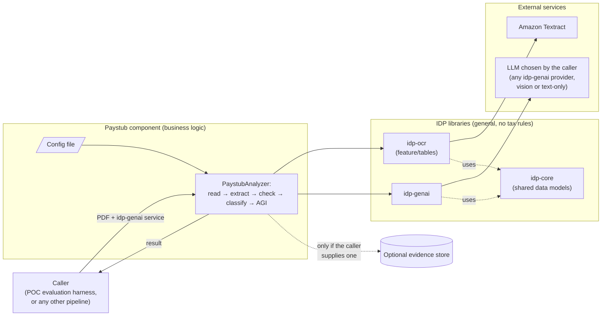
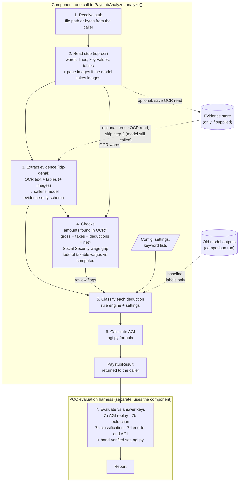
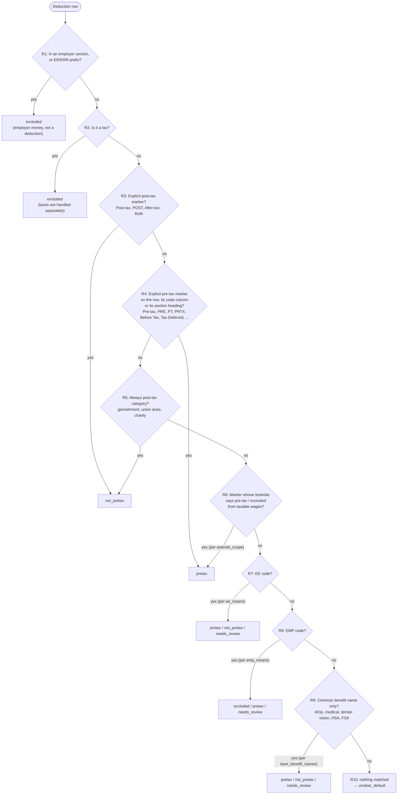

# Paystub pre-tax classification and AGI: architecture (POC)

> **Status:** draft, updated 2026-11-05. Proof of concept, not production.
> **Goal:** a **reusable, configurable component** that any caller can plug into its own pipeline, plus a separate evaluation harness for the POC.

---

## 1. What problem are we solving?

Federal student-loan **income-driven repayment** applications need an estimate of the applicant's yearly income. When the applicant sends a **paystub**, we estimate yearly **AGI** (Adjusted Gross Income) from that one stub.

The calculation is simple. The hard part is knowing **which deductions are "pre-tax"**:

```
AGI = (gross − one_time − pretax_deductions) × periods_per_year + one_time
```

| Term | Meaning |
|---|---|
| **Gross** | Everything the employee earned in this pay period, before taxes and deductions. |
| **One-time pay** | Bonus and overtime. Not repeated every period, so it's added once and not multiplied. Commission counts as regular pay. |
| **Pre-tax deduction** | Taken out *before* tax is calculated, so it lowers taxable income. **Subtracted** for AGI. |
| **Post-tax deduction** | Taken out *after* tax. Doesn't change taxable income. **Ignored** for AGI. |
| **Periods per year** | Weekly 52, biweekly 26, semimonthly 24, monthly 12. |

One wrong label changes AGI by *amount × periods*. For example, a $100 biweekly deduction marked wrongly shifts AGI by $2,600.

**Why it's hard:**
- Paystubs show pre-tax status in many different ways: a "Pre-Tax" heading, codes such as `PRE`/`PT`, an `*` with a footnote, a separate column, or nothing at all.
- Some codes are ambiguous. `EE` usually means "employee pays", which isn't the same as pre-tax. `EMP` means employer in some payroll systems and employee in others.
- An earlier model-comparison exercise across 82 synthetic stubs and several models found:
  - pre-tax labels correct only **about 75%** of the time;
  - **every** mismatch in the same direction: the answer key said "not pre-tax" and the model said "pre-tax";
  - most mismatched deductions (107 of 128) wrong in all 3 models compared.

**Root cause:** the extraction prompt gives the model a category rule ("health, dental and 401k are pre-tax"). It doesn't tell the model to look for evidence on the stub. Every model follows the same rule, so they make the same mistakes.

---

## 2. The core idea

> **The model reads the stub and copies down evidence. Our code decides what's pre-tax.**

| Job | Who does it | Why |
|---|---|---|
| Read the stub (OCR, tables, headings, footnotes) | IDP libraries + an LLM **chosen by the caller** | OCR finds the text and tables. The model turns them into clean evidence records. |
| Decide pre-tax / not pre-tax / needs review | **Our deterministic code** | The rules are still being agreed. In code they're explicit, testable and easy to change, and every decision can name the rule and the quoted evidence. |
| Calculate AGI | **Our deterministic code** | Arithmetic shouldn't be left to a model. |

**Results:**
- Changing a rule doesn't require re-running any model.
- Every decision can be explained, e.g. *"pre-tax because the deduction sits under the heading 'Pre-Tax Deductions'"*.
- Unclear cases are sent to review (`needs_review`) instead of being forced to true or false.

---

## 3. Key decisions

| # | Decision | Reason |
|---|---|---|
| D1 | **Use `idp-ocr` + `idp-genai` directly, not `idp-processor`.** | `idp-processor` handles single-value fields only. Its README says *"tables and nested/repeating fields are out of scope"*, and deductions are a variable-length list of rows. It's built on `idp-ocr` and `idp-genai` anyway. |
| D2 | **Get tables from `idp-ocr` (branch `feature/tables`).** | That branch adds table reading: Textract `TABLES` for scanned PDFs and pdfplumber table detection for digital PDFs. Each table comes back as rows and cells with a header row. This gives the model the row/column structure even when no page image is sent. |
| D3 | **Use OCR words as a check, not as the main source.** | Every amount the model returns should appear in the OCR text. If it doesn't, the model may have misread or invented it. |
| D4 | **Use `agi.py` from the model-comparison repo as the AGI reference.** | It's the formula the answer keys were calculated with, and the only one we can see. We only replace how it decides pre-tax: our rule engine instead of trusting the model's flag. |
| D5 | **Turn disputed rules into settings.** | Several rules aren't settled yet (section 7). The pipeline is built once, and the answers only change setting values. |
| D6 | **Keep everything in memory by default; saving is optional.** | A normal call passes results from step to step in memory and returns them. A caller *may* plug in a store to save the evidence (section 8.4), which the POC evaluation needs. |
| D7 | **Keep the code outside the IDP libraries.** | Tax rules are business logic. The libraries stay general. The business team agreed this should be a separate component; it may later move into the income domain pack. |
| D8 | **The caller chooses the model.** | The component takes a ready-made `idp-genai` service. Provider (Bedrock Converse, Bedrock Mantle, ...) and model are the caller's choice. If the model accepts images, page images are sent too; if not, it works from OCR text and tables only. |
| D9 | **Install the IDP libraries from GitHub branches, not Artifactory.** | The table support we need is only on an `idp-ocr` branch so far. Installing from GitHub lets us point at the right branch of each library (section 8.6). |
| D10 | **Build a reusable, configurable component.** | One public entry point, one config file, injectable dependencies, and each step usable on its own (section 8). The POC evaluation is just one user of the component. |

---

## 4. Architecture overview



The **caller** owns the input files, the model choice and whether anything is saved. The **component** owns the paystub logic. The **IDP libraries** own reading documents and calling models.

**POC inputs (S3 bucket `idp-paystub-model-comparison`; used by the evaluation harness, not by the component itself):**

| Item | Path | Used for |
|---|---|---|
| Paystub PDFs (82, synthetic) | `datasets/pay_stubs/paystubs/<folder>/<stub>.pdf` | Main input |
| Answer keys | `datasets/answer_keys/<folder>/<stub>.json` | Main automated check (known errors are triaged, step 7) |
| Model outputs from the comparison run (2026-10-14) | `runs/2026-10-14/<model>/<folder>/<stub>.json` | Baseline comparison |

The folders are `advs_paystubs` (10 stubs), `generated_complicated` (22) and `generated_scanned` (50).

---

## 5. The flow, end to end



**Everything inside the component runs in memory.** Each step hands its result object straight to the next one, and the final `PaystubResult` is returned to the caller. Nothing is written anywhere unless the caller plugs in an evidence store (section 8.4).

Steps 2–3 are **expensive**: they call Textract and a model. Steps 4–6 are **cheap and deterministic**: pure Python, no network.

### Step 1: Receive the stub
The caller passes a local file path or the file bytes. Getting the file (from S3, an upload, a queue) is the caller's job. In the POC, the evaluation harness downloads PDFs from S3 with the `default` AWS profile in `us-east-1`. PDFs stay out of git.

### Step 2: Read the stub (`idp-ocr`, branch `feature/tables`)
- The PDF is read with words **and tables** requested. `idp-ocr` picks the method:
  - **digital PDFs**: read the text layer and detect tables with pdfplumber (free, local). If no table is found anywhere in the document, it falls back to Textract;
  - **scanned PDFs** (no text layer, e.g. all of `generated_scanned`): Textract with `FORMS` and `TABLES`.
- **Output:** an `idp-core` `Document` with, for each page:
  - **words** and **lines**, each with its position (bounding box);
  - **key-value pairs** (e.g. "Pay Date: 07/17/2026");
  - **tables**: rows and cells with positions, header row marked.
- **Page images** are made with `idp_ocr.render_pages` **only if** the caller's model accepts images and the config allows it.
- **Limitations:**
  - Textract `LAYOUT` (section titles, footers) isn't requested. Headings *above* a table and footnotes *below* it come from the OCR lines, not from a structured field.
  - pdfplumber's detector needs a header band. Sections without one aren't detected, total rows may be merged into one cell, and ruled non-table text can show up as an extra table.

### Step 3: Extract evidence (`idp-genai`)
- One model call per stub, through the **`idp-genai` service the caller passed in**. The component doesn't pick the provider or model.
- **What the model receives:**
  - the OCR text, with each table written out as a grid (header row first);
  - the page images, but **only if** the service reports image support (`capabilities.image_media_types` isn't empty) and the config doesn't turn images off.
- **Text-only vs vision:**
  - text-only models depend on the OCR tables being right;
  - vision models can also fix tables the OCR got wrong.

  The evaluation compares both.
- The model is told to **copy what's printed**, not to decide anything.
- The output is checked against a strict schema. `idp-genai` rejects malformed or fenced JSON rather than repairing it.
- **What the model returns (draft schema):**

| Level | Field | Example |
|---|---|---|
| Stub | `gross_current` | `1760.00` |
| Stub | `net_current` | `1224.70` |
| Stub | `period_start`, `period_end`, `pay_date` | `07/01/2026` … |
| Stub | `pay_frequency_printed` | `"Biweekly"` or `null` |
| Stub | `federal_taxable_wages_printed` | `965.70` or `null` |
| Stub | `taxes[]`: label, amount | `"Social Security", 109.12` |
| Stub | `footnotes[]`: marker, text | `"*", "Excluded from federal taxable wages"` |
| Earnings row | label, amount, hours, rate | `"Overtime", 132.00` |
| Deduction row | `label` (verbatim) | `"DENTAL EE/SPOUSE"` |
| Deduction row | `amount` | `34.65` |
| Deduction row | `section_heading` (verbatim) | `"Pre-Tax Deductions"` / `"Deductions"` |
| Deduction row | `codes[]`: column header and value | `{"column": "Type", "value": "PRE"}` |
| Deduction row | `markers[]` | `["*"]` |
| Deduction row | `in_employer_section` | `true` for "Benefits" / "Employer Contributions" tables |

- **Rules for the model:**
  - Copy text exactly; don't normalise or interpret it.
  - If something isn't printed, return `null`. Never guess.
  - The schema has **no** `pretax` field, so the model can't apply a category rule.

### Step 4: Checks
Each check adds **flags** to the stub or to a deduction. Checks never change the extracted values.

| Check | How | What a failure means |
|---|---|---|
| **Grounding** | Each extracted amount must appear in the OCR words. | The model may have misread or invented the number. |
| **Net reconciliation** | gross − taxes − deductions ≈ net, within a few cents. | A row is missing, extra (often an employer row) or misread. |
| **Social Security wage gap** | Implied wages = Social Security tax ÷ 6.2%. Compare them with gross. Repeat with Medicare at 1.45%. | If the implied wages are clearly **below** gross, about that much was deducted before Social Security/Medicare tax. Usually that's health, dental, vision, HSA or FSA ("Section 125" benefits). |
| **Federal taxable wages** | If printed, compare with gross − deductions classified pre-tax. | If they don't match, a classification is probably wrong. |

**Social Security gap example (stub_0010):**
- Gross is $1,836.22, so with nothing pre-tax, Social Security would be $113.85.
- The stub shows $106.95, which means taxed wages of about $1,725.
- That leaves a gap of about $111. Health + dental + vision + accident insurance = $111.09.

**Limits of the Social Security check:**
- It can't reveal a 401k or pension, because those lower federal income tax but **not** Social Security tax.
- Social Security stops above a yearly wage cap.

So by default this check is only a **review flag**, not proof (see `tax_math_as_evidence`).

### Step 5: Classify each deduction (rule engine)
Each deduction row goes through the rules **in order**, and the **first rule that matches wins**. Each result has three parts:
- `decision`: `pretax`, `not_pretax`, `needs_review` or `excluded`;
- `rule_id`: which rule matched;
- `evidence`: the exact text that triggered it.



**Rule order:**
- **Agreed rules (R1–R5)** are applied first.
- **Disputed rules (R6–R10)** follow the settings in section 7.
- **Explicit post-tax** (R3) comes before **explicit pre-tax** (R4). That way "POST EE" or "Roth 401k" can never be caught by a pre-tax rule.

Flags from step 4 can move a decision to `needs_review`, for example when federal taxable wages don't match the classifications.

### Step 6: Calculate AGI (the `agi.py` formula)
```
one_time = sum of bonus and overtime earnings
pretax   = sum of deductions classified "pretax"
AGI      = (gross − one_time − pretax) × periods_per_year + one_time
```
- **Periods per year** come from the printed pay frequency. If it isn't printed, use the same fallback as `agi.py`. That fallback still has to be checked when porting the code.
- **Employer rows** (`excluded`) are never subtracted.
- **Federal taxable wages** aren't used in the formula. They're only checked in step 4, so our AGI stays comparable with the answer keys.
- **`needs_review` deductions are reported as a range:**
  - `agi` treats them as not pre-tax (higher AGI);
  - `agi_if_review_pretax` subtracts them (lower AGI);
  - the stub is marked `needs_review`.

### Step 7: Evaluate (POC harness only, not part of the component)
The harness runs the component over the 82 stubs, once per model and settings combination.

**The answer keys are the main automated check.** They're the only labels we have for all 82 stubs, and they tell us whether our code behaves as expected.

The business team has confirmed some keys are wrong (e.g. stub07, stub_0010). So the harness doesn't stop at a pass/fail percentage; it explains every mismatch. The comparison is split into four layers, so a failure points at **which part** of our code is wrong.

#### 7a. AGI arithmetic: replay the keys' own labels
- Feed each key's own amounts and `employee_pretax` labels into our `compute_agi()`.
- The result must equal the key's `calculated.agi` **to the cent, for all 82 stubs**.
- The key's AGI was calculated from those same labels, so this test doesn't depend on whether a label is right. It only checks that our AGI code reproduces `agi.py`.
- It runs as a normal unit test, with no model or network.

#### 7b. Extraction: did we read the stub correctly?
Compare our extracted evidence with the key:

| Field | How it's compared |
|---|---|
| Gross, net, pay frequency, period dates | Exact match (money within $0.01) |
| Deduction rows | Paired **by amount**, as the comparison run's scorer does. Reported: matched, missing (in key, not ours), extra (ours, not in key) |
| Bonus / overtime | Exact match; they drive the one-time part of AGI |

- Deduction **type names** aren't compared. The keys use normalised names (`health_insurance`); we keep the stub's exact wording.
- `total_deductions` in the keys is known to be inconsistent, so it's reported but not used as pass/fail.
- Extra rows that we classified `excluded` (employer contributions) are expected, not errors.

#### 7c. Classification: does our decision match the key's label?
For each deduction paired in 7b:

| Our decision | Key `true` | Key `false` |
|---|---|---|
| `pretax` | ✔ agree | ✖ we subtract, key doesn't |
| `not_pretax` | ✖ key subtracts, we don't | ✔ agree |
| `needs_review` | counted separately | counted separately |

**Every disagreement is sorted into one bucket** using the `rule_id` we recorded:

| Bucket | Meaning | Action |
|---|---|---|
| **Known key error** | Stub/deduction is on the confirmed-wrong list (`disputed_stubs`). | None; reported separately. |
| **Open question** | Decided by a disputed rule (R6–R10). | Expected until the rules are agreed. Shows how much each open question matters. |
| **Agreed rule disagrees** | Decided by R1–R5 (e.g. a clear "Pre-Tax" heading). | **Investigate.** Either our extraction/rule has a bug or the key is wrong. Check the PDF and record the outcome. |
| **Extraction problem** | Row missing, extra or wrong amount (from 7b). | Fix extraction first; classification can't be judged. |

**The code is working as expected when:**
- 7a matches **82/82**;
- 7b has no unexplained extraction errors;
- every disagreement in the **Agreed rule disagrees** bucket has been checked and turned out to be a key error.

#### 7d. End-to-end AGI
- Compare our final AGI with the key's AGI per stub, in dollars.
- Count stubs within $1 and list the largest gaps.
- Each gap can be traced back through 7b and 7c to the row that caused it.

#### Other references

| Compared with | Why |
|---|---|
| **Hand-verified set (~20 stubs)** | Settles the "Agreed rule disagrees" cases and acts as the trustworthy reference where keys are wrong. Record the **evidence** first; assign true/false once the rules are agreed. |
| **`agi.py` with the model's own flag** | Shows what our approach changes compared with the current method on the same stubs. |
| **Corrected answer keys (when available)** | The key location is a harness setting. When corrected keys arrive, point the harness at them and rerun. The saved OCR reads are reused; the model is called again (DL-039). |

**What the report shows:**
- 7a–7d results per model and per settings combination;
- the disagreement buckets, with stub, deduction, rule and quoted evidence for each;
- **both error directions** (subtracted when it shouldn't be, and missed when it should be);
- results per rule (how often each rule fires and how often it agrees with the key);
- `needs_review` counts.

**Caution:** the keys lean heavily towards "not pre-tax", so stricter settings will *look* better against them. That's why results are reported per settings combination, and disagreements are explained rather than just counted.

---

## 6. Worked examples

### stub_0006 (advs_paystubs): no markers anywhere
- **Gross:** $1,760, biweekly; no bonus or overtime.
- **Deductions** under a plain **"Deductions"** heading: Medical $85, Dental $12, 401k $70.40. No codes or markers.
- **Employer column:** "Pension ER $88" in a separate Benefits column.

**Checks:**
- **Social Security:** $1,760 × 6.2% = $109.12, exactly what's printed. **No gap**, so medical and dental weren't taken out before Social Security tax.
- **Net:** $1,760 − $367.90 (taxes) − $167.40 (deductions) = $1,224.70 ✔.

**Classification:**

| Row | Rule | Decision |
|---|---|---|
| Pension ER | R1 (employer) | excluded |
| Medical, Dental, 401k | R9 (benefit name only) | depends on `bare_benefit_names` |

**AGI:**
- `bare_benefit_names = needs_review`: **AGI = $45,760** ($1,760 × 26). If the review items turn out pre-tax, AGI = $41,407.60.
- The answer key says $45,760. The models said "pre-tax" and got $41,407.60, which is **$4,352.40** lower.

### stub_0002 (advs_paystubs): asterisk with a footnote
- "Health −87.00 \*", footnote "\* Excluded from federal taxable wages".
- The stub prints "federal taxable wages $965.70" = $1,052.70 − $87.

**Classification:** R6 matches **if** `asterisk_scope = any`, so Health is pre-tax. The federal-taxable-wages check agrees ($1,052.70 − $87 = $965.70). If the setting is `uniform_only`, Health falls through to R9.

**AGI:** assuming no bonus or overtime, ($1,052.70 − $87) × 26 = **$25,108.20**. The answer key labels Health pre-tax.

---

## 7. Settings (decided by the open questions)

| Setting | Options | Proposed POC default | Open question |
|---|---|---|---|
| `bare_benefit_names` | `pretax` / `not_pretax` / `needs_review` | `needs_review` | Is "401k $70.40" with no marker pre-tax? |
| `ee_means` | `pretax` / `not_pretax` / `needs_review` | `needs_review` | The business team says EE means pre-tax (stub07). On stub_0010 "EE/SPOUSE" looks like a coverage tier. |
| `emp_means` | `employer` (excluded) / `pretax` / `needs_review` | `needs_review` | Employer or employee? |
| `asterisk_scope` | `any` / `uniform_only` | `any` | Does the asterisk rule apply only to uniform reimbursements? |
| `tax_math_as_evidence` | `flag_only` / `decide` | `flag_only` | Can a Social Security wage gap alone make a deduction pre-tax? |
| `unclear_default` | `not_pretax` / `needs_review` | `needs_review` | No indicator at all, e.g. "Hospital Indemnity $6.76". |
| `disputed_stubs` | list of stub IDs | stub07, stub_0010 | Keys known to be wrong; reported separately. |

Running with every setting at its `needs_review` value shows exactly how many decisions depend on the open questions.

---

## 8. Component design (reusable and configurable)

### 8.1 Public API
One main entry point, plus each step as its own function so a caller can use only the part it needs:

```python
from paystub_agi import PaystubAnalyzer, AnalyzerConfig

analyzer = PaystubAnalyzer(
    config=AnalyzerConfig.from_yaml("paystub.yaml"),
    genai=my_genai_service,  # any idp-genai service; the caller picks provider and model
    reader=None,             # optional: a custom idp-ocr reader
    store=None,              # optional: saves OCR reads; None = nothing is saved
)

result = analyzer.analyze("stub_0006.pdf")  # or bytes
result.agi                       # 45760.00
result.agi_if_review_pretax      # 41407.60
result.status                    # "ok" | "needs_review"
result.deductions[0].decision    # "needs_review"
result.deductions[0].rule_id     # "R9"
result.deductions[0].evidence    # quoted text that triggered the rule
result.flags                     # e.g. ["ss_wage_gap", "net_mismatch"]
```

| Function | Needs network? | Use on its own when... |
|---|---|---|
| `analyzer.read(source)` → `Document` | Yes (Textract for scans) | You only want OCR + tables. |
| `analyzer.extract(document)` → `PaystubEvidence` | Yes (model) | You want the evidence records. |
| `run_checks(evidence, document, config)` → flags | No | You already have evidence from elsewhere. |
| `classify(evidence, flags, config)` → decisions | No | You only need the pre-tax decisions, e.g. another pipeline already extracts deductions. |
| `compute_agi(evidence, decisions, config)` → `AgiResult` | No | You only need the AGI arithmetic. |

The last three are **pure functions**: same input, same output, no AWS, no model. That makes them easy to unit-test and reuse.

### 8.2 Configuration
One YAML file, loaded into a validated Pydantic `AnalyzerConfig`. Every value has a default, so an empty file works.

```yaml
reading:
  features: [words, tables]
  force_ocr: false            # true = always use Textract

extraction:
  send_images: auto           # auto = only if the model accepts images | never
  max_images: 3

checks:
  money_tolerance: 0.02
  social_security_rate: 0.062
  medicare_rate: 0.0145

rules:                        # section 7
  bare_benefit_names: needs_review
  ee_means: needs_review
  emp_means: needs_review
  asterisk_scope: any
  tax_math_as_evidence: flag_only
  unclear_default: needs_review
  keywords:                   # editable without code changes
    pretax_markers: ["pre-tax", "pretax", "pre tax", "PRE", "PT", "PRTX", "before tax", "tax deferred", "tax sheltered"]
    posttax_markers: ["post-tax", "posttax", "POST", "after-tax", "roth"]
    posttax_categories: ["garnish", "union dues", "charit"]
    employer_markers: ["ER", "ERR", "employer", "company paid"]
    employer_sections: ["benefits", "employer contributions", "payroll benefits"]
    benefit_names: ["401k", "403b", "457", "medical", "health", "dental", "vision", "hsa", "fsa"]

agi:
  one_time_earnings: [bonus, overtime]
  periods_per_year: {weekly: 52, biweekly: 26, semimonthly: 24, monthly: 12}
```

**What can change without touching code:** every setting, every keyword list, tolerances and the one-time earning types.

**What is fixed in code:** the rule order (R1–R10) and the AGI formula. These are the parts we want to keep reviewed and tested.

### 8.3 What the caller plugs in (dependency injection)

| Plug-in | Required? | Default | Why it's injected |
|---|---|---|---|
| `genai`: an `idp-genai` service | **Yes** | — | The caller decides provider, model, credentials and region. |
| `reader`: an `idp-ocr` reader | No | `idp-ocr` automatic reader (digital first, Textract for scans) | E.g. to use a different Textract client or region. |
| `store`: an evidence store | No | none (in memory only) | See 8.4. |

### 8.4 In memory vs saved OCR reads
**By default nothing is saved.** `analyze()` works entirely in memory and returns a `PaystubResult`, like any normal function.

The optional **evidence store** saves only the **OCR read** (the document text and which reader produced it). When the same stub is analysed again, the component loads the read instead of calling Textract again.

**The model's answer is never saved for reuse (DL-039).** The model is called on every run, even for the same stub and model, because the same model can give different answers for the same stub. Reusing a saved answer would hide that variation.

**Why the POC needs it:**

| Reason | Explanation |
|---|---|
| **Cost and time** | Evaluation means running 82 stubs × several models × several settings combinations. With a store, Textract runs **once** per stub, shared by every model and every run. |
| **Same input for every model** | All models read exactly the same OCR text, so differences between them come from the models, not from the OCR. |

**How a saved read is found (DL-038):**
- by the file's **contents** (a SHA-256 fingerprint), plus the reader order and the saved format, so a renamed stub is still found and a changed file isn't;
- a damaged or unreadable saved read stops with a clear error instead of silently paying again;
- file names are the fingerprint only, so they can't point outside the folder.

**What the component provides:**

| Piece | Behaviour |
|---|---|
| `EvidenceStore` | A tiny interface with `get(key)` and `put(key, value)`. |
| `FileEvidenceStore` | Writes one JSON file per saved read to a local folder chosen by the caller. Enough for the POC. |
| Other stores (e.g. S3, a database) | A production caller can write its own, or use none. |

The **evaluation harness** uses `FileEvidenceStore` with a git-ignored folder (the files contain paystub text). A production caller would typically pass none.

### 8.5 Package layout

```
idp-paystub-usecase/
├── pyproject.toml              # dependencies from GitHub branches (8.6)
├── src/paystub_agi/            # the reusable component
│   ├── __init__.py             # public API: PaystubAnalyzer, AnalyzerConfig, classify, compute_agi, ...
│   ├── config.py               # AnalyzerConfig (Pydantic) + YAML loading + defaults
│   ├── models.py               # PaystubEvidence, Decision, AgiResult, PaystubResult
│   ├── reading.py              # idp-ocr call: words + tables, optional page images
│   ├── extraction.py           # evidence-only schema + prompt + idp-genai call
│   ├── checks.py               # grounding, net reconciliation, Social Security gap, federal taxable wages
│   ├── rules.py                # rule engine R1–R10
│   ├── agi.py                  # AGI formula (agi.py reference)
│   ├── store.py                # EvidenceStore interface + FileEvidenceStore (OCR reads only)
│   └── analyzer.py             # PaystubAnalyzer: wires the steps together
├── config/default.yaml         # documented defaults
├── evaluation/                 # POC harness, NOT part of the package
│   ├── run.py                  # download stubs, run the component per model/settings
│   ├── baseline.py             # adapter: old model outputs → classify()
│   └── score.py                # 7a–7d vs answer keys, hand-verified set, agi.py
├── tests/                      # unit tests for checks, rules and AGI (no network)
└── docs/
```

The component (`src/paystub_agi`) never imports anything from `evaluation/`. That one-way dependency is what keeps it reusable: the evaluation can be thrown away without touching the component.

### 8.6 Installing the IDP libraries from GitHub
The libraries come straight from GitHub branches instead of Artifactory. All three repos are under `https://github.com/maximus-idp/`.

| Library | Branch | Why this branch |
|---|---|---|
| `idp-core` | `main` | Has the `Table` / `TableCell` / `PageLayout` models; `idp-ocr feature/tables` itself points at `idp-core main`. |
| `idp-ocr` | `feature/tables` | Textract `TABLES` + pdfplumber tables. Not on `main` yet. |
| `idp-genai` | `feature/bedrock-mantle` | Adds the Mantle provider next to Converse, so callers can choose either. |

The libraries use `uv` and target Python 3.14, so the POC does too:

```toml
[project]
name = "paystub-agi"
requires-python = ">=3.14"
dependencies = ["idp-core", "idp-ocr", "idp-genai", "pydantic", "pyyaml"]

[tool.uv.sources]
idp-core  = { git = "https://github.com/maximus-idp/idp-core",  branch = "main" }
idp-ocr   = { git = "https://github.com/maximus-idp/idp-ocr",   branch = "feature/tables" }
idp-genai = { git = "https://github.com/maximus-idp/idp-genai", branch = "feature/bedrock-mantle" }
```

**Notes:**
- **Pinned commits:** a branch keeps moving, but `uv.lock` records the **exact commit** that was installed. Builds stay reproducible until we deliberately run `uv lock --upgrade-package idp-ocr` (or another library).
- **One `idp-core` for all:** `idp-genai`'s own config points `idp-core` at Artifactory. Our `[tool.uv.sources]` overrides that, so all three libraries share the GitHub `idp-core`.
- **GitHub access:** installing needs git access to the `maximus-idp` organisation (e.g. Git Credential Manager or a token).
- **Without uv** (pip): `pip install "idp-ocr @ git+https://github.com/maximus-idp/idp-ocr@feature/tables"`, and the same pattern for the others.
- **Later:** once tables are merged and released, switch back to versioned packages from Artifactory.

---

## 9. Where things live

| Item | Location |
|---|---|
| Component code | `src/paystub_agi/` in this repo, outside the IDP libraries |
| Evaluation harness | `evaluation/` in this repo |
| Architecture (this file) | `docs/architecture.md` |
| Running notes and history | `summary.md` |
| Local sample PDFs (not committed) | `docs/paystubs/` |
| Saved OCR reads (evaluation only) | a git-ignored folder under `data/`, one `<fingerprint>.json` per read (proposed) |
| Evaluation results | `evaluation/results/<run_id>/` (proposed) |
| AGI reference | `agi.py` in the repo `idp-paystub-model-comparison/paystub-extractor` |

**Environment:**
- **S3** works with the `default` AWS profile in `us-east-1`.
- **Bedrock Mantle**, if the caller uses it, is **blocked while on VPN**; turn VPN off for those model calls.
- **GitHub** access is needed to install the IDP libraries.

---

## 10. Out of scope

- **Calculating tax.** "AGI" here is a yearly income estimate from one paystub, not a tax return.
- **Changing the IDP libraries.** Gaps go to the library team instead (below).
- **Production deployment.** A "production" classifier has been mentioned; where it lives and how it works is unknown, so it isn't part of this design.
- **Other document types** (W-2, tax returns, etc.).

## 11. Gaps to raise for the IDP libraries
General capabilities, with no tax rules:
1. **`idp-ocr`:**
   - merge and release `feature/tables`;
   - add Textract **layout** (section titles, footers) so headings and footnotes come back as structured fields.
2. **`idp-genai`:** built-in support for "unknown" answers and for **source evidence** (quoted text, page) per extracted value.
3. **`idp-processor`:** support for repeating rows / tables, so documents like paystubs could use it.

## 12. Glossary

| Term | Meaning |
|---|---|
| **AGI** | Adjusted Gross Income: here, a yearly income estimate from one paystub. |
| **Federal taxable wages** | Gross minus deductions excluded from federal income tax. Sometimes printed as "FIT Wages" or "Fed Taxable Gross". |
| **Social Security / Medicare wages** | What the 6.2% / 1.45% taxes are charged on. A 401k doesn't lower these; health, dental and vision usually do. |
| **Section 125 (cafeteria plan)** | Employer benefit plan that makes health, dental, vision, HSA and FSA pre-tax for **both** federal income tax and Social Security/Medicare. |
| **Traditional vs Roth 401k** | Traditional is pre-tax for federal income tax; Roth is post-tax. |
| **EE / ER** | Employee / employer: **who pays**, not tax treatment. |
| **Employer contributions** | Employer money, e.g. 401k match or "Pension ER". Not part of gross and never subtracted. |
| **Imputed income** | Taxable non-cash benefit, e.g. employer-paid life insurance over $50k. |
| **Textract** | AWS service that reads text from scanned documents. |
| **Bedrock Converse / Mantle** | Two ways `idp-genai` can call models on AWS Bedrock. Mantle is OpenAI-compatible. The caller picks one. |
| **Evidence store** | Optional place to save the OCR read so Textract isn't called again for the same stub. The model is always called again. Off by default. |
| **`needs_review`** | The rules can't decide from the evidence; a person must check. |
